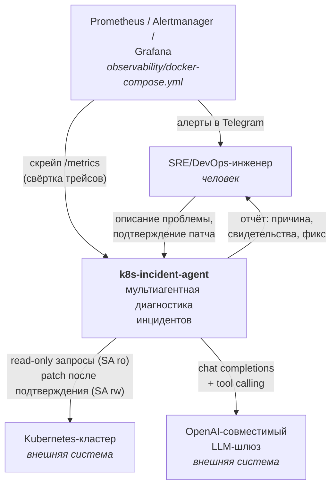
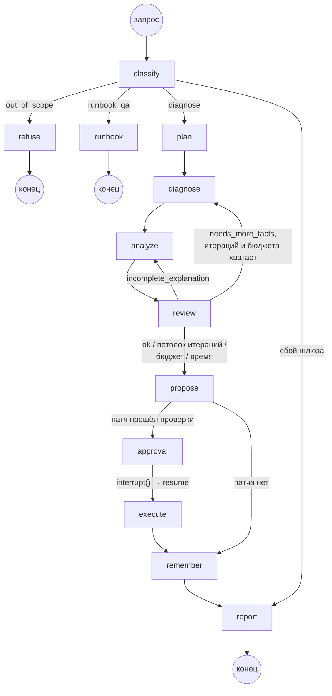
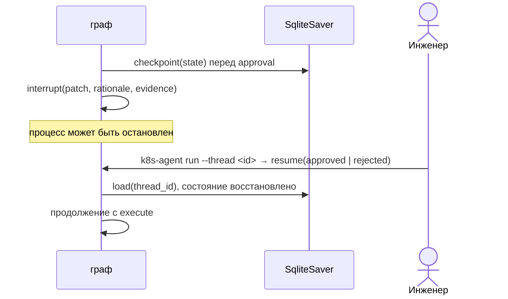

# Архитектура k8s-incident-agent

Версия 1.0, 2026-10-10: сверено с кодом после М4–М8. Дополняет раздел 5 `docs/TZ.md`.

## 1. Принципы, из которых выведена архитектура

1. **Факты отделены от суждений.** Инструменты возвращают свидетельства с id; гипотезы ссылаются на id.
   Отсюда явное поле `evidence` в состоянии, а не свободный текст в истории сообщений.
2. **Мутация — отдельный контур.** Диагностика и исполнение разведены по агентам, ServiceAccount'ам
   и узлам графа, между ними обязательное прерывание с подтверждением человека.
3. **Граф, а не диалог.** Маршрут детерминирован кодом, LLM решает только внутри узла. Это даёт
   воспроизводимость evals и понятные метрики по шагам.
4. **Ограниченные циклы.** Любая петля (ревью → доработка) имеет счётчик и жёсткий потолок.

## 2. C4 уровень 1 — контекст



Границы: система не подписывается на алерты и не следит за кластером постоянно — точка входа всегда
запрос человека (раздел 1 ТЗ).

## 3. C4 уровень 2 — контейнеры

```mermaid
flowchart TB
    subgraph host["Ноутбук автора / CI-раннер"]
        subgraph net["docker-сеть agent-egress (internal, без выхода наружу)"]
            subgraph agentc["Контейнер agent (uid 10001, read-only rootfs, cap_drop ALL)"]
                cli["CLI k8s-agent<br/><i>typer</i>"]
                graph["Граф LangGraph<br/><i>graph.py</i>"]
                tools["Read-only инструменты<br/><i>маскирование, обрезка</i>"]
                exec["Исполнитель<br/><i>executor.py, белый список</i>"]
                mem["Эпизодическая память<br/><i>SQLite FTS5</i>"]
            end
            proxy["egress-proxy<br/><i>tinyproxy, allowlist имя:порт</i>"]
        end
        data[("том agent-data<br/>checkpoints, memory,<br/>traces/*.jsonl")]
        kind["kind-кластер<br/><i>стенд S1–S4</i>"]
        obs["Prometheus + Alertmanager<br/>+ Grafana"]
        metrics["k8s-agent metrics serve<br/><i>/metrics из трейсов</i>"]
    end
    gw["Внешний LLM-шлюз"]

    cli --> graph
    graph --> tools
    graph --> exec
    graph --> mem
    mem --> data
    graph -->|"трейс"| data
    tools -->|"SA incident-agent-ro"| proxy
    exec -->|"SA incident-agent-rw"| proxy
    graph -->|"HTTPS"| proxy
    proxy -->|"k8s-incident-agent-control-plane:6443"| kind
    proxy -->|"llm-api.flant.ru:443"| gw
    metrics -->|"читает"| data
    obs -->|"скрейп"| metrics
```

Egress агента — только через прокси, и только на две пары «имя:порт»: LLM-шлюз и kube-apiserver.
Прямого маршрута наружу у сети нет (`inhibit_ipv4`), DNS внешних имён не резолвится. Проверяется
`make isolation-test` (40 проверок, `docs/ISOLATION.md` §10). Стек наблюдаемости — отдельный
compose-файл, чтобы не трогать изоляцию агента.

## 4. C4 уровень 3 — компоненты графа

Граф ровно как в `build_graph()` (`src/k8s_incident_agent/graph.py`):



| Узел | Что делает | Модель | Инструменты и данные |
|---|---|---|---|
| `classify` | маршрут запроса (оркестратор) | `Route` | — |
| `refuse` | вежливый отказ фиксированным текстом | нет | — |
| `runbook` | ответ на общий вопрос: раздел runbook выбирается по оглавлению | `RunbookPick` + текст | `agent/RUNBOOKS` |
| `plan` | скилл по `triggers` (кодом) и план сбора фактов | `Plan` | `skills/` |
| `diagnose` | цикл «модель → вызовы инструментов» внутри узла, бюджет на каждой попытке | tool calling | 7 read-only инструментов |
| `analyze` | гипотезы со ссылками на свидетельства; поиск похожих в памяти и суждение «тот же класс?» | `Hypotheses` | `memory.search` |
| `review` | обоснованность и полнота по симптомам из запроса | `ReviewVerdict` | — |
| `propose` | патч или рекомендация; белый список и привязка к фактам — кодом | `PatchProposal` (json_object) | — |
| `approval` | `interrupt()`: продолжить может только человек | нет | — |
| `execute` | сверка uid/generation, патч учёткой rw, пост-проверка раскатки | нет | `executor.py` |
| `remember` | запись инцидента в память из проверенных фактов | нет | `memory.write` |
| `report` | отчёт F10 | нет | — |

Поддерживающие компоненты: реестр инструментов с pydantic-схемами аргументов (`tools/`), хранилище
свидетельств (`evidence.py`), загрузчик знаний (`knowledge.py`), чекпоинтер `SqliteSaver`, трейс
(`trace.py`), клиент шлюза (`llm.py`).

## 5. Состояние графа

`IncidentState` в `graph.py` (TypedDict, `total=False`):

```python
query: str; started: float; thread_id: str
route: str                                  # diagnose | runbook_qa | out_of_scope | failed
plan: list[dict]; active_skill: str | None
evidence: Annotated[list[dict], operator.add]     # {id: ev-NNN, tool, args, ts, summary, raw_ref}
hypotheses: list[dict]                      # {id, statement, evidence_ids[], confidence}
similar_incidents: list[dict]               # прошлые инциденты + same_class + difference
gaps: list[str]; review_verdict: str; review_iterations: int
proposed_patch: dict | None                 # {kind, name, namespace, patch, rationale,
                                            #  evidence_ids, expected: {uid, generation}}
recommendation: str; approval_status: str; execution_result: dict | None
tool_calls: int; llm_calls: int; cost: float; budget_exhausted: bool
notes: Annotated[list[str], operator.add]   # что пошло не так — раздел «Ограничения» отчёта
incident_id: str | None; report: str
```

Сырой вывод инструментов в состояние не кладётся: он живёт в `EvidenceStore` процесса, в промпт
попадает выдержкой (3000 символов на свидетельство), а в состоянии — ссылка `raw_ref`.

Три исхода ревью различаются намеренно: `needs_more_facts` («данных мало») и
`incomplete_explanation` («данных хватает, но гипотеза объясняет не все симптомы») требуют разных
действий — в первом случае диагност собирает факты, во втором аналитик пересматривает гипотезу.

Инварианты проверяются кодом, а не подсказками модели (тесты — `tests/test_graph.py`,
`tests/test_executor.py`):

- гипотеза со ссылкой на несуществующее свидетельство отбрасывается; так же — ссылка на прошлый
  инцидент, которого не вернул поиск;
- патч проходит белый список путей, запрет `null` и директив `$…`, `replicas ≥ 1`; целевой объект —
  только тот, чей манифест прочитан в этом инциденте; контейнеры и Secret в ссылках — только увиденные;
- `execute` не вызывает исполнителя без `approval_status == "approved"`; исполнитель сверяет uid и
  generation живого объекта с прочитанными при показе патча;
- `tool_calls` (каждая попытка, включая отклонённые) и `review_iterations` не превышают потолков
  `config.budget` — при превышении граф идёт к `propose` и отчёту с пометкой, а не обрывается.

## 6. Sequence: основной сценарий (S1, CrashLoopBackOff)

```mermaid
sequenceDiagram
    actor U as Инженер
    participant G as граф (classify/plan)
    participant D as diagnose
    participant T as read-only tools
    participant A as analyze
    participant M as память
    participant R as review
    participant P as propose
    participant E as execute
    participant K as kube-apiserver

    U->>G: «Под api в ns payments в CrashLoopBackOff»
    G->>G: classify = diagnose; скилл crashloop-diagnosis (по triggers)
    G->>G: план: поды, describe, logs(previous), манифест, здоровый сосед
    loop пока модель просит инструменты и бюджет есть
        D->>T: k8s_list_pods / k8s_describe / k8s_logs(previous=true) / k8s_get_manifest
        T->>K: GET (SA read-only, через egress-proxy)
        K-->>T: ответ
        T-->>D: свидетельство ev-NNN (секреты маскированы, вывод обрезан)
    end
    A->>M: search(запрос, namespace)
    M-->>A: прошлые инциденты (0..3)
    A->>A: h-1 «нет env DB_PASSWORD» (ev-003, ev-004); прошлый inc — тот же класс
    A->>R: гипотезы
    R-->>P: verdict ok
    P->>P: патч env DB_PASSWORD ← secretKeyRef payments-db/password; проверки кодом
    P-->>U: патч, обоснование, свидетельства — interrupt()
    U->>E: «y» (resume)
    E->>K: GET: uid/generation те же?
    E->>K: PATCH (SA rw, белый список)
    E->>K: пост-проверка: раскатка завершена
    E->>M: remember: запись resolved
    G-->>U: отчёт F10 + id в памяти + ссылка на трейс
```

## 7. Sequence: human-in-the-loop и восстановление



Ключевое: подтверждение — не поле, которое модель может выставить сама. Узел `approval` вызывает
`interrupt()`, и единственный способ продолжить — внешний `resume` с решением человека. `k8s_patch`
диагносту не зарегистрирован, а исполнитель создаёт клиент из другого kubeconfig и SA. `--thread`
принимается только для инцидента, который ждёт подтверждения: новый запрос поверх старого чекпоинта
унаследовал бы чужие свидетельства.

## 7a. Реализация: отличия от проекта

Все отличия — в сторону простоты, каждое с обоснованием в `docs/DEFENSE.md` и `docs/adr/`:

- цикл «диагност ⇄ инструменты» живёт внутри узла `diagnose`, а не рёбрами графа: бюджет проверяется
  на каждой попытке, граф остаётся читаемым;
- отказ — фиксированный текст без вызова модели: детерминированно и бесплатно;
- модель вызывается своим тонким клиентом (`llm.py`) — тем же, что в сравнении моделей; LangGraph даёт
  граф, чекпоинтер и `interrupt()`; `reasoning_effort: low` (замер М5: S1 199 → 26–45 с);
- `propose` получает схему текстом и `json_object`: на открытом поле патча json_schema зацикливал шлюз;
- запись в память собирает код, а не отдельный вызов модели; эмбеддингов нет (FTS5 + фильтры +
  суждение аналитика);
- трейс — JSONL на прогон, метрики считаются из трейсов при скрейпе; Langfuse и Loki не поднимаются.

## 8. Ошибки и деградация

| Ситуация | Поведение |
|---|---|
| Инструмент вернул ошибку API-сервера или RBAC | свидетельство со статусом `error`, модель видит текст ошибки и выбирает следующий шаг |
| Модель вызвала незарегистрированный инструмент, без namespace, не по схеме | отказ кодом (`denied` в трейсе), попытка тратит бюджет |
| Невалидный structured output | повтор с текстом ошибки валидации, максимум 2; затем пометка в «Ограничениях» и безопасный результат узла |
| Шлюз не ответил (таймаут, 5xx после повторов) | узел не падает: пометка в отчёте, граф идёт дальше с тем, что собрано |
| Бюджет вызовов, итераций или времени исчерпан | `propose` по собранным фактам, отчёт с пометкой «бюджет исчерпан» |
| Объект изменился между показом патча и подтверждением | `stale`: патч не применяется, нужен новый прогон |
| Пост-проверка раскатки не прошла | `post_check_failed`, автоотката нет, в отчёте команда отката |

## 9. Что осознанно отложено до v2

- Несколько кластеров и контекстов одновременно.
- Автономный запуск по алерту из Alertmanager (сейчас точка входа только человек).
- Параллельное исполнение нескольких ветвей диагностики (fan-out по гипотезам).
- Темпоральный граф знаний вместо плоской эпизодической памяти (`docs/MEMORY.md`, «Путь апгрейда»).
