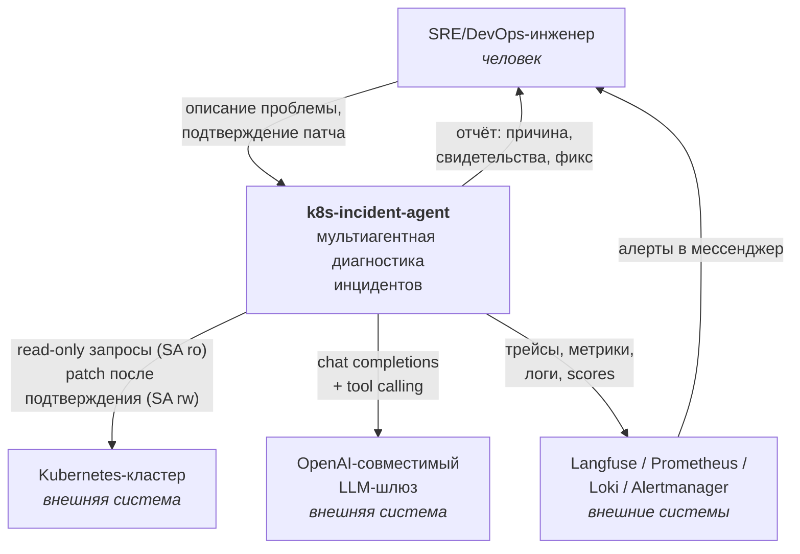
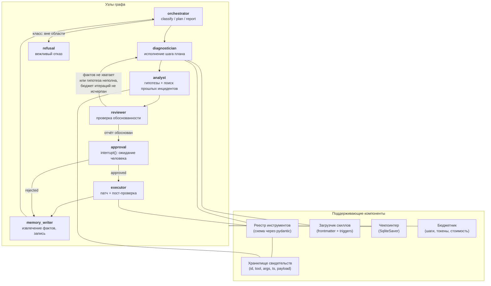
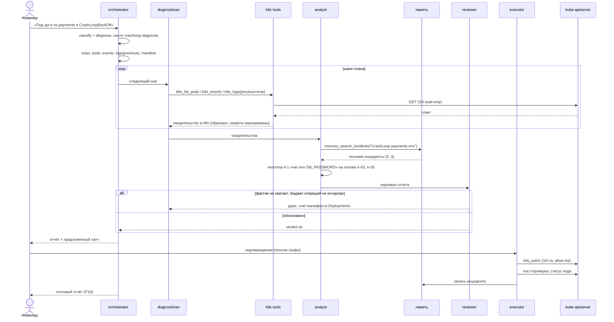
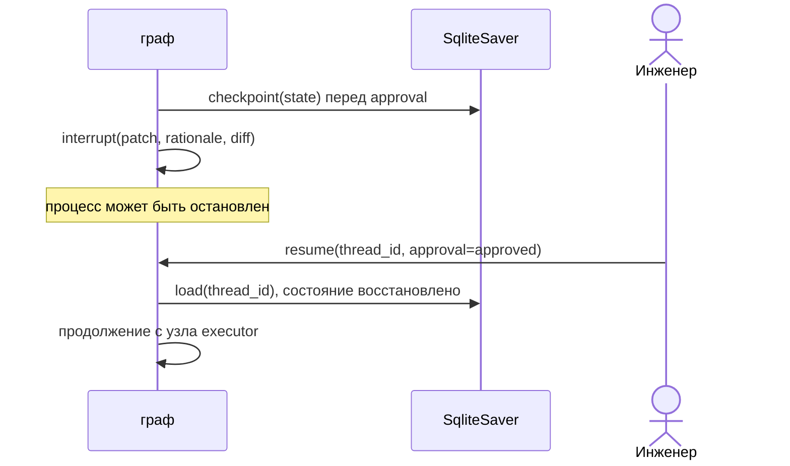

# Архитектура k8s-incident-agent

Версия 0.1, 2026-09-28. Дополняет раздел 5 `docs/TZ.md`.

## 1. Принципы, из которых выведена архитектура

1. **Факты отделены от суждений.** Инструменты возвращают свидетельства с id; гипотезы ссылаются на id.
   Отсюда явное поле `evidence` в состоянии, а не свободный текст в истории сообщений.
2. **Мутация — отдельный контур.** Диагностика и исполнение разведены по агентам, ServiceAccount'ам
   и узлам графа, между ними обязательное прерывание с подтверждением человека.
3. **Граф, а не диалог.** Маршрут детерминирован кодом, LLM решает только внутри узла. Это даёт
   воспроизводимость evals и понятные метрики по шагам.
4. **Ограниченные циклы.** Любая петля (ревью → доработка) имеет счётчик и жёсткий потолок.

## 2. C4 уровень 1 — контекст



Границы: система не подписывается на алерты и не следит за кластером постоянно — точка входа всегда
запрос человека (раздел 1 ТЗ).

## 3. C4 уровень 2 — контейнеры

```mermaid
flowchart TB
    subgraph host["Рабочая станция / CI-раннер"]
        subgraph agentc["Контейнер agent (non-root, ro-rootfs, cap-drop ALL)"]
            cli["CLI / чат-адаптер<br/><i>Python, typer</i>"]
            graph["LangGraph-рантайм<br/><i>узлы агентов, роутер</i>"]
            tools["Слой инструментов<br/><i>k8s-клиент, маскирование,<br/>обрезка вывода</i>"]
            mem["Слой памяти<br/><i>SQLite FTS5 + bge-m3</i>"]
        end
        sqlite[("SQLite<br/>чекпоинты + инциденты<br/><i>том, rw</i>")]
        kind["kind-кластер<br/><i>цель диагностики</i>"]
        lf["Langfuse<br/><i>docker-compose</i>"]
        prom["Prometheus + Grafana<br/>+ Loki + Alertmanager"]
    end
    gw["Внешний LLM-шлюз<br/>(fallback: vLLM локально)"]

    cli --> graph
    graph --> tools
    graph --> mem
    mem --> sqlite
    graph --> sqlite
    tools -->|"kube-apiserver, TLS"| kind
    graph -->|"HTTPS"| gw
    graph -->|"OTLP / SDK"| lf
    graph -->|"scrape /metrics"| prom
```

Egress контейнера ограничен двумя направлениями: адрес LLM-шлюза из `local.env` и адрес kube-apiserver.
Всё остальное закрыто (подробности в `docs/ISOLATION.md`).

## 4. C4 уровень 3 — компоненты графа



Нотация: сплошная стрелка — переход графа (кто кого вызывает), стрелка с подписью — условный переход,
линия без стрелки — узел пользуется инфраструктурным компонентом.

Роли узлов и их контракты:

| Узел | Читает из состояния | Пишет в состояние | Инструменты |
|---|---|---|---|
| `orchestrator` | `query`, `report_draft` | `route`, `plan`, `report` | нет |
| `diagnostician` | `plan`, `evidence`, `active_skill` | `evidence[]`, `plan` (корректировка) | k8s read-only |
| `analyst` | `evidence[]` | `hypotheses[]`, `similar_incidents[]` | `memory_search_incidents`, `runbook_lookup` |
| `reviewer` | `hypotheses[]`, `evidence[]`, `report_draft` | `review_verdict`, `gaps[]`, `review_iterations++` | нет |
| `approval` | `proposed_patch` | `approval_status` | нет (interrupt) |
| `executor` | `proposed_patch` | `execution_result`, `post_check` | k8s patch (allow-list) |
| `memory_writer` | всё состояние | `incident_id` | запись в эпизодическую память |

## 5. Состояние графа

```python
class IncidentState(TypedDict):
    # вход
    query: str
    thread_id: str
    # роутинг и план
    route: Literal["diagnose", "runbook_qa", "out_of_scope"]
    plan: list[PlanStep]            # {id, goal, tool_hint, status}
    active_skill: str | None
    # факты и суждения
    evidence: list[Evidence]        # {id, tool, args, ts, summary, raw_ref}
    hypotheses: list[Hypothesis]    # {id, statement, evidence_ids[], confidence}
    similar_incidents: list[IncidentRef]
    # ревью
    report_draft: str | None
    review_verdict: Literal["ok", "needs_more_facts",
                            "incomplete_explanation"] | None
    gaps: list[str]
    review_iterations: int          # потолок: budget.max_review_iterations
    # исполнение
    proposed_patch: Patch | None    # {kind, name, namespace, patch, rationale}
    approval_status: Literal["pending", "approved", "rejected"] | None
    execution_result: dict | None
    # бюджет
    tool_calls: int                 # потолок: budget.max_tool_calls
    tokens_in: int
    tokens_out: int
    cost_usd: float
```

Списки (`evidence`, `hypotheses`) объявлены как reducer-поля LangGraph
(`Annotated[list, operator.add]`). В v1 шаги плана выполняются последовательно, но модель может
вернуть несколько tool calls в одном ответе, и их результаты дописываются в список конкурентно —
reducer нужен уже для этого. Fan-out по ветвям плана отложен до v2 (раздел 9), reducer-поля делают
его возможным без смены схемы состояния.

Три исхода ревью различаются намеренно: `needs_more_facts` («данных мало») и
`incomplete_explanation` («данных хватает, но гипотеза объясняет не все симптомы») требуют разных
действий — в первом случае диагност собирает факты, во втором аналитик пересматривает гипотезу.
Без этого различия требование F5 «причина объясняет все симптомы» схлопывается в groundedness
и перестаёт проверяться отдельно.

Инварианты проверяются кодом, а не подсказками модели:

- любой `hypothesis.evidence_ids` непуст, и все id существуют в `evidence`;
- `executor` не вызывается, если `approval_status != "approved"`;
- `tool_calls` и `review_iterations` не превышают потолков из `config.budget` (значения и их
  происхождение — `docs/TZ.md`, N3 и F5) — при превышении граф идёт в `orchestrator`
  с частичным отчётом и пометкой «бюджет исчерпан», а не обрывается молча.

## 6. Sequence: основной сценарий (S1, CrashLoopBackOff)



## 7. Sequence: human-in-the-loop и восстановление



Ключевое: подтверждение — не поле, которое модель может выставить сама. Узел `approval`
вызывает `interrupt()` LangGraph, и единственный способ продолжить — внешний `resume` с решением
человека. Вызов `k8s_patch` физически недоступен диагностическому контуру: инструмент
зарегистрирован только в `executor`, а его клиент создан с другим kubeconfig и SA.

## 8. Ошибки и деградация

| Ситуация | Поведение |
|---|---|
| Инструмент вернул ошибку API-сервера | свидетельство со статусом `error`, план корректируется, одна попытка альтернативного инструмента |
| LLM вернул невалидный structured output | повтор с текстом ошибки валидации, максимум 2 раза, затем возврат в `orchestrator` с пометкой |
| Бюджет шагов или токенов исчерпан | частичный отчёт со списком непроверенных гипотез |
| `executor` применил патч, пост-проверка не прошла | результат помечен `post_check_failed`, автоотката нет, пользователю выдаётся команда отката |
| Память недоступна | диагностика продолжается без похожих инцидентов, в отчёте пометка |

## 9. Что осознанно отложено до v2

- Несколько кластеров и контекстов одновременно.
- Автономный запуск по алерту из Alertmanager (сейчас точка входа только человек).
- Параллельное исполнение нескольких ветвей диагностики (fan-out по гипотезам).
- Темпоральный граф знаний вместо плоской эпизодической памяти (`docs/MEMORY.md`, «Путь апгрейда»).
