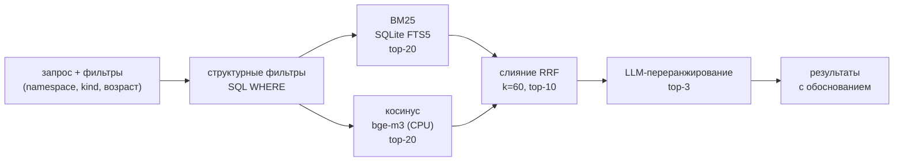
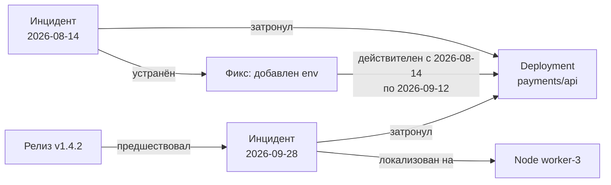

# Память k8s-incident-agent

Версия 0.1, 2026-09-28. Раскрывает раздел 8 `docs/TZ.md`.

## 1. Зачем агенту память отдельно от контекста

Контекстное окно — это рабочая память одного запуска: она исчезает вместе с процессом и не переживает
прерывание на подтверждение человека. Для диагностики инцидентов нужны три вещи, которых окно не даёт:

- **пережить interrupt** — между показом патча и подтверждением может пройти час;
- **узнать повторяющуюся поломку** — сценарий S5 прямо требует найти прошлый случай;
- **иметь знания, которые не переписывает модель** — runbook'и и принципы поведения.

Отсюда три слоя с разным временем жизни и разной изменяемостью.

| Слой | Время жизни | Кто пишет | Хранилище |
|---|---|---|---|
| Рабочая | один инцидент | рантайм графа | SQLite (чекпоинты) |
| Эпизодическая | постоянно | `memory_writer` после закрытия инцидента | SQLite (FTS5 + вектора) |
| Семантическая и процедурная | постоянно | человек, через git | Markdown-файлы |

## 2. Слой 1 — рабочая память

Состояние графа (`IncidentState`, см. `docs/ARCHITECTURE.md`) плюс `SqliteSaver` LangGraph.
Ключ — `thread_id`, один инцидент = один тред.

Что даёт чекпоинтер:

- `interrupt()` на узле `approval` и `resume` после подтверждения (F6);
- перезапуск после падения процесса с последнего успешного узла;
- возможность посмотреть состояние постфактум при разборе неудачного прогона.

**Сжатие истории.** Бюджет контекста задаётся конфигом (по умолчанию 60% окна модели). При превышении
история сообщений узла сворачивается сводкой, но **список свидетельств не сжимается** — сворачивается
только переписка. Свидетельства хранятся отдельными записями и подставляются в промпт выборочно:
узлу передаются только те, на которые ссылается текущий шаг плана или проверяемая гипотеза.
Это и есть основной способ не упереться в окно: длинные логи никогда не живут в истории целиком.

**Обрезка на уровне инструмента.** Каждый инструмент возвращает `summary` (в промпт) и `raw_ref`
(ссылка на полный вывод в SQLite). Лимит по умолчанию: 4000 символов на свидетельство,
логи — последние N строк плюс все строки, совпавшие с паттернами ошибок.

## 3. Слой 2 — эпизодическая память инцидентов

### 3.1 Схема

```sql
CREATE TABLE incidents (
    id            TEXT PRIMARY KEY,          -- inc-2026-09-28-001
    created_at    TEXT NOT NULL,             -- ISO8601, UTC
    cluster       TEXT NOT NULL,
    namespace     TEXT,
    kinds         TEXT,                      -- JSON: ["Deployment","Pod"]
    objects       TEXT,                      -- JSON: ["payments/api"]
    symptoms      TEXT NOT NULL,             -- что наблюдалось
    root_cause    TEXT NOT NULL,             -- причина
    fix           TEXT NOT NULL,             -- что помогло
    fix_applied   INTEGER NOT NULL,          -- 0/1: патч реально применялся
    outcome       TEXT,                      -- resolved | mitigated | unresolved
    evidence_ids  TEXT,                      -- JSON
    trace_id      TEXT,                      -- ссылка в Langfuse
    schema_ver    INTEGER NOT NULL DEFAULT 1,
    superseded_by TEXT REFERENCES incidents(id)  -- версионирование записи
);

CREATE VIRTUAL TABLE incidents_fts USING fts5(
    symptoms, root_cause, fix, objects,
    content='incidents', content_rowid='rowid',
    tokenize='unicode61 remove_diacritics 2'
);

CREATE TABLE incident_vectors (
    incident_id TEXT PRIMARY KEY REFERENCES incidents(id),
    model       TEXT NOT NULL,               -- bge-m3
    dim         INTEGER NOT NULL,
    vec         BLOB NOT NULL                -- float32, нормализован
);
```

Вектор считается по конкатенации `symptoms + root_cause`, а не по всему тексту: поиск идёт от симптома,
и подмешивание текста фикса размывает эмбеддинг.

### 3.2 Запись

Срабатывает после закрытия инцидента, до финального отчёта.

1. Модель извлекает структурированную запись из состояния графа (structured output по pydantic-схеме).
2. **Валидация кодом:** `root_cause` непуст, `evidence_ids` существуют, `namespace`/`kinds`
   соответствуют реально затронутым объектам из свидетельств.
3. **Ревью записи** отдельным вызовом: «следует ли эта причина из этих свидетельств?».
   Отказ → запись сохраняется с `outcome = unresolved` и не участвует в поиске по умолчанию.
4. Дедупликация: если гибридный поиск находит запись с совпадением выше порога (0.9) и тем же
   `namespace`+`objects`, новая запись помечает старую через `superseded_by`, а не создаёт дубль.

Что **запрещено** сохранять (дублируется в `agent/MEMORY.md` как правило для модели и проверяется кодом):
значения Secret и ConfigMap, токены, содержимое переменных окружения, персональные данные из логов,
сырые логи целиком.

### 3.3 Поиск

`memory_search_incidents(query, filters)` — три канала и слияние.



Детали:

- **Фильтры применяются первыми**, а не после ранжирования: «inc в namespace payments за последние
  90 дней» — это условие, а не предпочтение.
- **Слияние RRF** (reciprocal rank fusion, `score = Σ 1/(k + rank)`) вместо взвешенной суммы:
  не требует калибровки шкал BM25 и косинуса друг под друга.
- **Временной вес:** записи старше 180 дней получают штраф, потому что фикс мог устареть вместе с
  версией приложения. Штраф — множитель к итоговому score, а не жёсткая отсечка.
- **LLM-переранжирование** top-10 → top-3 с явным вопросом «тот же ли это класс поломки»,
  и обязательным полем «чем отличается от текущего случая» — это отличие попадает в отчёт.

### 3.4 Эмбеддинги локально

`/embeddings` доступного шлюза закрыт (проверено запросом, см. `docs/LLM_SELECTION.md`, раздел 2 —
там же дата проверки), поэтому bge-m3 гоняется локально на CPU через `sentence-transformers`. База v1 — сотни записей, инкрементальный пересчёт при записи, полный
пересчёт только при смене модели (поле `model` в `incident_vectors` позволяет его обнаружить).
Если база вырастет: квантизация модели, затем вынос в отдельный сервис.

## 4. Слой 3 — семантическая и процедурная память

Markdown-файлы в git; состав каталогов `agent/` и `skills/` задан в `docs/TZ.md`, раздел 7.

Навигация **без векторов**, по подходу PageIndex: строится дерево оглавлений (файл → заголовки →
подзаголовки), модель выбирает релевантный узел по названиям, читается только выбранный раздел.

Почему так, а не RAG по чанкам:

- корпус маленький и структурированный — оглавление целиком влезает в промпт;
- runbook — это процедура, у неё есть порядок шагов, разрезание на чанки его ломает;
- выбор по оглавлению объясним: в трейсе видно, какой раздел и почему был выбран.

`SOUL.md` и `IDENTITY.md` подставляются в системный промпт всегда. Скилл подключается оркестратором
по `triggers` из фронтматтера — сначала по ключевым словам, при неоднозначности — выбором модели.

**Где этот подход перестанет работать.** Он держится на том, что дерево оглавлений целиком влезает
в промпт. Для v1 это ~10 файлов и порядка сотни заголовков. Признак исчерпания: оглавление
перестаёт помещаться в бюджет узла или выбор раздела начинает промахиваться чаще, чем в одном
случае из десяти. Тогда — двухуровневый PageIndex (сначала выбор файла по аннотациям, потом раздела
внутри него), и только если и этого не хватит — векторный индекс поверх заголовков. Плоский RAG
по чанкам не возвращается ни на одном из шагов по причинам из раздела 5.

## 5. Почему не «просто RAG поверх инцидентов»

| Проблема плоского RAG | Что ломается конкретно | Решение здесь |
|---|---|---|
| Чанкинг рвёт структуру | симптом и причина попадают в разные чанки, находится симптом без причины | инцидент — одна запись с полями, чанкинга нет |
| Нет времени | подсказывает фикс, устаревший вместе с версией приложения | временной вес + `superseded_by` |
| Ложные совпадения по общим словам | «pod», «CrashLoop», «error» есть почти в каждой записи | BM25 в паре с векторами + структурные фильтры |
| Нет структурных ограничений | находит инцидент из другого namespace и другого kind | фильтры до ранжирования |
| Нет различения симптома и причины | поиск по симптому возвращает записи, где эта строка была в фиксе | вектор только по `symptoms + root_cause`, поля разделены |

## 6. Сравнение готовых решений

Обзор на сентябрь 2026; версии и возможности проектов меняются быстро, перед финальным решением
стоит перепроверить актуальное состояние каждого.

| Решение | Что даёт | Решающая причина отказа |
|---|---|---|
| **Mem0** | извлечение фактов из диалога, вектор + опциональный граф | единица памяти — факт из переписки, а не структурированный инцидент |
| **Zep** | управляемый сервис памяти поверх Graphiti | внешний сервис в контуре — прямое нарушение N2 |
| **Letta** (ex-MemGPT) | агент с самоуправляемой памятью и подкачкой контекста | приносит собственный рантайм агента — конфликт с LangGraph |
| **LangMem** | SDK памяти поверх LangGraph Store, semantic/episodic/procedural | выигрыш сводится к обёрткам: наш поиск всё равно писался бы руками |
| **Cognee** | ECL-пайплайн: граф знаний + векторный индекс из документов | тяжёлый ingest ради корпуса в сотни записей |
| **Graphiti** | темпоральный граф, факты с интервалами валидности | требует графовую БД и LLM-вызов на каждом ingest — несоразмерно v1 |
| **memU** | память агента в виде файлов и папок | молодой проект, мало гарантий по стабильности API |
| **PageIndex** | reasoning-RAG по дереву оглавлений, без векторов | не хранилище, а навигация — **взят** для слоя 3 (раздел 4) |

Дополнительные соображения, где решающей причины было мало:

- **Mem0**: доменные поля (namespace, kind, объекты) пришлось бы держать в метаданных и фильтровать
  вручную, теряя главное преимущество готового решения; эмбеддер подключаемый, но настройка под
  локальный CPU-инференс кладёт ещё один слой поверх нашего.
- **LangMem**: идеологически ближе всех, но привязывает схему к абстракции Store и её индексу —
  RRF, структурные фильтры и временной вес туда не встраиваются, а живут рядом.
- **Cognee**: непрозрачно, что именно попало в граф, — это плохо для объяснимости отчёта, который
  агент обязан подкреплять свидетельствами.
- **Graphiti**: по смыслу самое близкое к задаче, поэтому оставлено как путь апгрейда (раздел 7),
  а не отвергнуто.

Вывод: для v1 берём SQLite + FTS5 + локальные эмбеддинги + LLM-rerank. Это ~300 строк кода, ноль
внешних сервисов, полный контроль над схемой и ранжированием, всё воспроизводится одной командой (N6).

## 7. Путь апгрейда: темпоральный граф

Когда упрёмся в плоскую модель (признаки: нужны запросы вида «что менялось в этом Deployment между
инцидентами», «какие инциденты связаны через общий узел кластера»), переходим на Graphiti + FalkorDB.

Модель графа:



Ключевое отличие: у рёбер есть интервал валидности, поэтому «фикс работал, пока не вышел релиз v1.4.2»
выражается в данных, а не в тексте. Миграция: `incidents` — это уже узлы, остаётся добавить рёбра;
интерфейс `memory_search_incidents` не меняется, меняется реализация.

## 8. Открытые вопросы

Все числовые параметры этого документа — стартовые эвристики, а не измеренные значения:

- Порог дедупликации 0.9 взят априорно, калибруется на eval-наборе S5.
- Временной штраф (180 дней) для v1 — эвристика; правильнее считать от частоты релизов приложения.
- Бюджет контекста 60% окна модели (раздел 2) — запас под системный промпт, скилл и свидетельства;
  проверяется профилем реальных прогонов, а не расчётом.
- Лимит 4000 символов на свидетельство (раздел 2) выбран так, чтобы 15 свидетельств худшего случая
  (потолок N3) укладывались в бюджет узла у модели со 128k окна. При смене модели пересчитывается.
- `k=60` в RRF — значение из исходной работы по reciprocal rank fusion, не подбиралось под наши данные.
- Нужно ли хранить неудачные диагностики как отдельный класс — пока сохраняем с `outcome=unresolved`
  и исключаем из поиска, но они могут быть полезны как «здесь эта гипотеза не подтвердилась».
