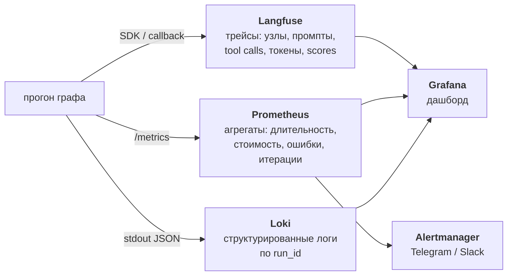

# Наблюдаемость k8s-incident-agent

Версия 0.1, 2026-09-28. Раскрывает раздел 11 и требования N4–N5 `docs/TZ.md`.

> **Статус:** кода пока нет. Имена метрик, структура трейса и правила алертов ниже — проектный
> контракт; пороги в алертах стартовые (см. раздел 5).

## 1. Чем наблюдаемость агента отличается от наблюдаемости сервиса

У обычного сервиса единица работы — HTTP-запрос, он либо успешен, либо нет, и стоит одинаково.
У агента единица работы — прогон графа: он идёт минуты, состоит из разнородных шагов, стоит денег,
и, главное, **может завершиться успешно и при этом быть неправильным**. Отсюда три отличия:

1. трекинг по шагам графа и вызовам LLM, а не по запросу;
2. стоимость — первоклассная метрика, а не деталь биллинга;
3. качество (правильность причины, обоснованность) — тоже метрика, приходит из evals как scores.



Сквозной ключ — `run_id`: он же `trace_id` в Langfuse, лейбл в логах и ссылка в записи инцидента
(поле `trace_id` в таблице `incidents`). По нему из любой точки можно попасть в остальные.

## 2. Трейсы (Langfuse)

Иерархия трейса повторяет граф, а не стек вызовов:

```
trace: incident run_id=r-8f21  [query, route, итог]
├─ span  orchestrator.classify        → route=diagnose
│  └─ generation  model=..., tokens, cost
├─ span  orchestrator.plan            → 4 шага
├─ span  diagnostician.step[1]
│  ├─ generation  (выбор инструмента)
│  └─ span  tool:k8s_list_pods        → evidence e-01, 340 мс
├─ span  diagnostician.step[2]
│  └─ span  tool:k8s_logs             → evidence e-02, обрезано 4000/18220
├─ span  analyst
│  ├─ span  tool:memory_search_incidents → 2 совпадения, rerank
│  └─ generation  → hypotheses[h-1]
├─ span  reviewer (iteration=1)       → verdict=needs_more_facts
├─ span  diagnostician.step[5]
├─ span  reviewer (iteration=2)       → verdict=ok
├─ span  approval                     → interrupt, ожидание 00:04:12
├─ span  executor
│  ├─ span  tool:k8s_patch            → applied
│  └─ span  post_check                → ok
└─ span  memory_writer                → inc-2026-09-28-001
```

Что фиксируется обязательно:

- **на каждом generation:** модель, температура, промпт и ответ, `usage` (in/out токены), стоимость,
  латентность, номер повтора при ошибке валидации structured output;
- **на каждом tool-span:** имя, аргументы, id свидетельства, длительность, факт обрезки
  (`raw_len` → `kept_len`), флаг `masked=true`, если сработало маскирование;
- **на approval:** время ожидания человека — оно исключается из метрики длительности прогона,
  иначе p95 меряет скорость человека, а не системы;
- **теги трейса:** `scenario`, `namespace`, `model`, `commit`, `env=dev|eval|prod`.

Промпты и ответы уходят в Langfuse уже после маскирования (`docs/ISOLATION.md`, раздел 6) — в трейс
незамаскированное значение Secret не попадает.

**Scores** пишутся туда же: из evals — `root_cause_accuracy`, `groundedness`, `tool_precision`,
`refusal_accuracy` (формулы и пороги приёмки — `docs/EVALS.md`, раздел 5); из продуктового контура —
обратная связь инженера (`accepted` / `rejected` патча), это единственный источник качества на живых
прогонах.

## 3. Метрики (Prometheus)

| Метрика | Тип | Лейблы | Зачем |
|---|---|---|---|
| `agent_runs_total` | counter | `route`, `outcome` (resolved / unresolved / refused / budget_exceeded / error) | базовый объём и распределение исходов |
| `agent_run_duration_seconds` | histogram | `route` | N3, время ожидания человека вычтено |
| `agent_llm_tokens_total` | counter | `model`, `node`, `direction` (in/out) | где именно жгутся токены |
| `agent_llm_cost_usd_total` | counter | `model`, `node` | N4: стоимость инцидента |
| `agent_run_cost_usd` | histogram | `route` | распределение, а не только сумма — ловит редкие дорогие прогоны |
| `agent_tool_calls_total` | counter | `tool`, `status` (ok / error / denied) | бюджет вызовов (N3), здоровье инструментов |
| `agent_tool_duration_seconds` | histogram | `tool` | медленный API-сервер или logs с большим tail |
| `agent_review_iterations` | histogram | — | зацикливание: упор в потолок из `config.budget` |
| `agent_structured_output_retries_total` | counter | `model`, `node` | нестабильность формата у открытой модели (риск из раздела 13 ТЗ) |
| `agent_approvals_total` | counter | `decision` (approved / rejected / timeout) | доля отклонённых патчей — прокси качества предложений |
| `agent_memory_search_hits` | histogram | — | сколько похожих инцидентов находится; резкий рост нулей = деградация памяти |
| `agent_masked_values_total` | counter | `tool` | маскирование срабатывает — значит, работает |
| `agent_evidence_truncated_total` | counter | `tool` | часто обрезаем → лимит подобран неверно |

Метрики отдаются на `/metrics` внутри контейнера, Prometheus скрейпит их из compose-сети.
Для коротких прогонов (CLI завершается быстрее интервала скрейпа) используется pushgateway.

Отдельно стоит сказать, почему `agent_run_cost_usd` — гистограмма, а не только counter: средняя
стоимость скрывает хвост. Один прогон, ушедший в цикл на 50 вызовов, важнее, чем сдвиг среднего
на копейки, и виден только в p99.

## 4. Логи

Структурированный JSON в stdout, сбор в Loki через docker-драйвер.

```json
{
  "ts": "2026-09-28T17:04:11.238Z",
  "level": "info",
  "run_id": "r-8f21",
  "trace_id": "r-8f21",
  "node": "diagnostician",
  "step": 2,
  "event": "tool_call",
  "tool": "k8s_logs",
  "args": {"pod": "api-7d9c", "container": "api", "previous": true, "tail": 200},
  "evidence_id": "e-02",
  "duration_ms": 412,
  "raw_len": 18220,
  "kept_len": 4000,
  "masked": false
}
```

Правила: никаких промптов и ответов модели в логах (они в Langfuse, где есть контроль доступа);
никаких значений из кластера — только метаданные и длины; `run_id` в каждой строке.

## 5. Алерты

Одно правило целиком, как образец формы:

```yaml
groups:
  - name: k8s-incident-agent
    rules:
      - alert: AgentUnapprovedMutation
        expr: increase(agent_tool_calls_total{tool=~"k8s_patch|k8s_rollout_restart",
                                              status="denied"}[5m]) > 0
        for: 0m
        labels: { severity: critical }
        annotations:
          summary: "попытка мутации без подтверждения заблокирована — разбор обязателен"
```

У этого правила `for: 0m` намеренно: это не деградация, а событие безопасности. Даже одна
заблокированная попытка означает, что что-то в контуре повело себя не так, как спроектировано,
и накапливать статистику тут нечего.

Остальные правила той же формы:

| Алерт | Условие | Порог | for | severity |
|---|---|---|---|---|
| `AgentLatencyHigh` | p95 `agent_run_duration_seconds` за 30 мин | > `budget.max_seconds` | 15m | warning |
| `AgentRunCostHigh` | p95 `agent_run_cost_usd` за час | > $0.50 | 30m | warning |
| `AgentToolErrorRate` | доля `status="error"` от всех вызовов за 15 мин | > 0.2 | 10m | warning |
| `AgentReviewLooping` | доля прогонов, уложившихся в одну итерацию ревью | < 0.5 | 30m | warning |
| `AgentBudgetExceeded` | доля прогонов с `outcome="budget_exceeded"` за час | > 0.15 | 30m | warning |
| `AgentFormatInstability` | `rate(agent_structured_output_retries_total)` по модели | > 0.5/мин | 20m | warning |

Маршрутизация: `critical` → Telegram немедленно; `warning` → Slack с группировкой по 30 минут.

**Откуда пороги.** Только два из них выведены: `AgentLatencyHigh` берёт значение прямо из бюджета
N3, `AgentUnapprovedMutation` — из требования «ноль мутаций без подтверждения» (N1), поэтому у него
нет порога вообще. Остальные четыре — стартовые значения, выбранные как «заметно хуже, чем на
eval-прогонах»; они калибруются по первому месяцу эксплуатации, когда появится базовая линия.
До этого они работают как грубый детектор аномалий, а не как SLO.

**Про стоимость.** Целевая медиана прогона — $0.05 (используется в формуле выбора модели,
`docs/LLM_SELECTION.md`, раздел 6). Порог алерта задан на p95 и на порядок выше, потому что хвост
распределения формируют прогоны с полной второй итерацией ревью и длинными логами: это примерно
удвоение вызовов модели при кратно большем контексте. $0.50 — это «дороже, чем объяснимо второй
итерацией», то есть признак зацикливания, а не нормального тяжёлого инцидента.

## 6. Дашборд Grafana

Четыре ряда, сверху вниз — от «работает ли» к «почему дорого».

| Ряд | Панели |
|---|---|
| **Здоровье** | прогоны в час по `outcome`; p50/p95 длительности; доля ошибок инструментов; текущие активные прогоны |
| **Стоимость** | стоимость в час; p50/p95/p99 стоимости прогона; токены по узлам (stacked) — сразу видно, какой агент ест контекст |
| **Качество** | root-cause accuracy и groundedness из Langfuse scores (тренд по коммитам); доля отказов и ложных отказов; доля отклонённых человеком патчей; memory hit rate |
| **Поведение** | распределение числа вызовов инструментов; итерации ревью; top-инструменты по частоте и по времени; повторы structured output |

Ряд «Качество» — единственный, который не строится из данных рантайма: он заполняется прогонами
evals. Поэтому на дашборде рядом с ним выводится аннотация «последний полный eval: <дата, commit>»,
чтобы не смотреть на устаревший тренд как на текущее состояние.

## 7. Риск и запасной вариант

Langfuse self-hosted — это Postgres, ClickHouse, Redis, S3-совместимое хранилище и несколько
контейнеров. Для ноутбука это много (риск из раздела 13 ТЗ).

План замены: интерфейс трассировки закрыт тонким слоем с двумя реализациями — Langfuse и
OpenTelemetry/OTLP. Если Langfuse окажется тяжёлым, включается Phoenix (Arize) или чистый
OTLP-коллектор. Теряются при этом только scores из evals как хранилище — их можно писать в SQLite
рядом с результатами прогонов. Метрики, логи и алерты не затрагиваются вовсе, так как идут мимо
Langfuse.
